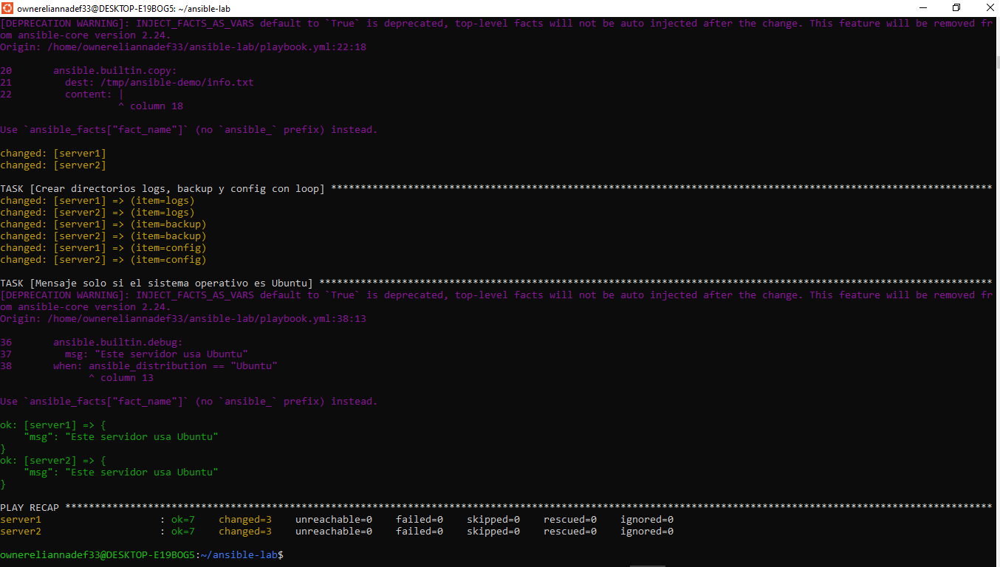

# Practica 2do Parcial Ansible

## Objetivo de la practica
Crear un laboratorio con dos servidores Linux (contenedores Ubuntu 24.04) usando Docker y administrarlos con Ansible.

## Comandos para iniciar los contenedores
docker compose up -d
docker ps

Instalar Python en cada contenedor:
docker exec server1 bash -c "apt update && apt install -y python3"
docker exec server2 bash -c "apt update && apt install -y python3"

Probar la conexion:
ansible docker -i inventory.ini -m ping

## Comando para ejecutar el playbook
ansible-playbook -i inventory.ini playbook.yml

## Captura de la ejecucion exitosa

